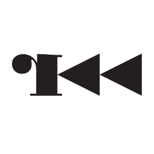
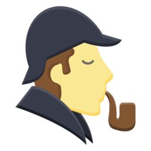

  

  
  

---

##  About Me

- Student exploring web development, OSINT, digital security, and reverse engineering, driven by curiosity about how systems really work.
- I build web apps with HTML, CSS, JavaScript, and **React**: school portals, exam systems, e-voting, and admin dashboards.
- I reverse engineer modded games and APKs to learn how protections are built and how they fail.
- I offer Android application security testing, only on assets with written authorization.
- Currently exploring: Frida internals, APK deobfuscation, edge deployment, OSINT workflows, and Ghidra scripting.
- My rule: *ship it, then make it better*.
- Portfolio: [bidzzofc.my.id](https://bidzzofc.my.id)

---

## Tech Stack

  

### Reverse Engineering & Tools

<table align="center">
  <tr align="center">
    <td valign="middle"></td>
    <td valign="middle"></td>
    <td valign="middle"><a href="https://github.com/radareorg/radare2"><picture><source media="(prefers-color-scheme: dark)" srcset="assets/radare2-dark.png" /></picture></a></td>
    <td valign="middle"></td>
    <td valign="middle"></td>
    <td valign="middle"></td>
  </tr>
  <tr align="center">
    <td>IDA Pro</td>
    <td>Ghidra</td>
    <td>radare2</td>
    <td>Frida</td>
    <td>Reqable</td>
    <td>MT Manager</td>
  </tr>
</table>

### OSINT

<table align="center">
  <tr align="center">
    <td valign="middle"></td>
    <td valign="middle"></td>
    <td valign="middle"></td>
  </tr>
  <tr align="center">
    <td>theHarvester</td>
    <td>Sherlock</td>
    <td>GHunt</td>
  </tr>
</table>

Logos belong to their respective projects.

---

## Public Projects

  
  
  
   
  
  
  

---

## GitHub Stats

  

---

## Contributions

  <picture>
    <source media="(prefers-color-scheme: dark)" srcset="https://raw.githubusercontent.com/BIDZZ-RAWR/BIDZZ-RAWR/output/github-contribution-grid-snake-dark.svg" />
    <source media="(prefers-color-scheme: light)" srcset="https://raw.githubusercontent.com/BIDZZ-RAWR/BIDZZ-RAWR/output/github-contribution-grid-snake.svg" />
    
  </picture>

